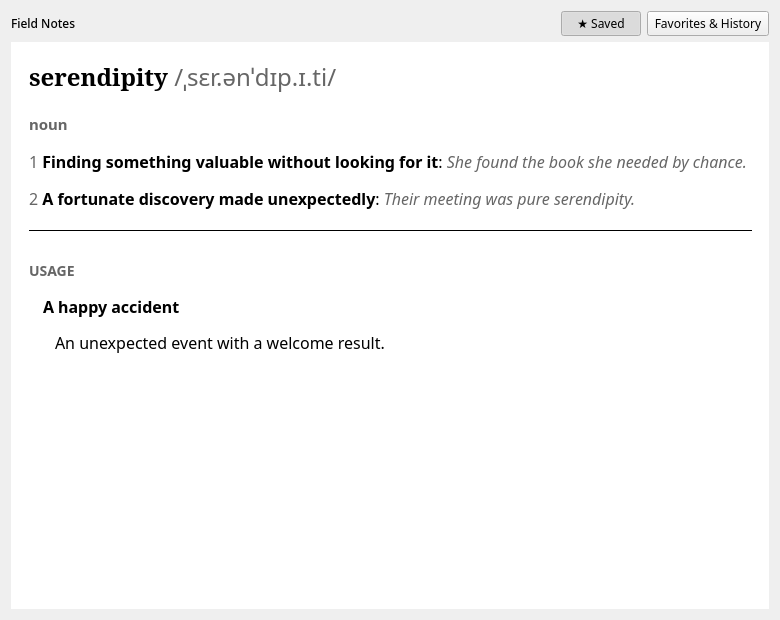
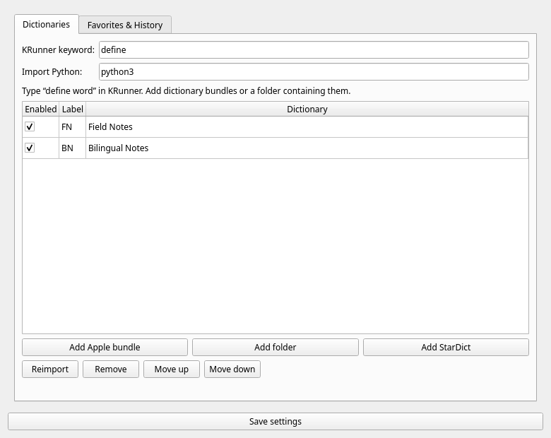
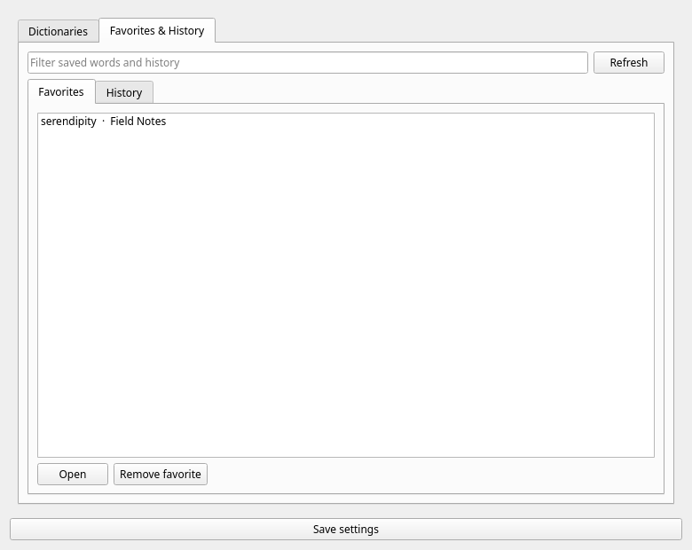

# Wordspring Runner

An offline dictionary lookup plugin for Plasma 6 KRunner. Type `define word` to see up to four short meanings from each enabled dictionary; press Enter to read the full entry in a styled article window. Save favorite entries and revisit recent lookups from settings. The trigger word is configurable.

| Article | Dictionaries | Favorites and history |
| --- | --- | --- |
|  |  |  |

The screenshots use synthetic entries. No dictionary data is included in the repository or releases.

## Features

- Import original macOS `.dictionary` bundles directly, or StarDict `.ifo` files with their companion `.idx`, `.dict` or `.dict.dz`, and optional `.syn` files.
- Add a folder to discover multiple dictionary bundles and StarDict files. Enable, disable, reorder, reimport, or remove sources in settings. Each source has an editable short label for KRunner; for example, Oxford Dictionary of English defaults to **ODE**.
- Keep an indexed SQLite copy of each dictionary in your XDG data directory. Lookup opens only the enabled databases and never runs the importer.
- Use the Apple bundle's semantic markup to distinguish headwords, pronunciation, parts of speech, numbered senses, examples, phrases, and origins. Original Apple CSS, audio, and embedded images are not included.
- Star an entry in the article window. The **Favorites & History** page lets you filter and reopen saved words, remove favorites, and clear lookup history independently of favorites.

## Requirements

- Plasma 6, Qt 6, KDE Frameworks 6 (KRunner, KCMUtils, KConfig, KCoreAddons, KI18n), SQLite, and a C++17 compiler.
- Python 3 for dictionary import. StarDict import uses only the Python standard library.
- For Apple import, install the packages in [`importer/requirements-apple.txt`](importer/requirements-apple.txt) into the Python environment used by Wordspring.

On Arch-based systems, the build dependencies are:

```bash
sudo pacman -S --needed cmake ninja gcc qt6-base krunner kcmutils kconfig kcoreaddons ki18n sqlite python
```

Create an isolated Apple import environment:

```bash
python -m venv ~/.local/share/wordspring/import-venv
~/.local/share/wordspring/import-venv/bin/python -m pip install -r importer/requirements-apple.txt
```

If your Python installation does not provide `pip`, use `uv venv` and `uv pip install --python` with the same requirements file. Set **Import Python** in Wordspring settings to the environment's `bin/python` path. PyGlossary is used only when importing Apple files; it is not needed to search previously imported dictionaries.

## Build and install

```bash
cmake -S . -B build -G Ninja -DCMAKE_BUILD_TYPE=Release -DCMAKE_INSTALL_PREFIX=/usr
cmake --build build
ctest --test-dir build --output-on-failure
sudo cmake --install build
```

The install adds a native KRunner plugin, its configuration module, the `wordspring` article and settings application, and the importer. Restart KRunner or log out and back in so Plasma discovers the new plugin.

For a per-user installation, configure with `-DCMAKE_INSTALL_PREFIX="$HOME/.local"`, run `cmake --install build` without `sudo`, and copy [`scripts/wordspring-plasma-env.sh`](scripts/wordspring-plasma-env.sh) into `~/.config/plasma-workspace/env/`. Log out and back in so Plasma includes the user plugin directory in Qt's search path.

Open **System Settings → Search → Plasma Search → Wordspring Runner** to configure sources. You can also run `wordspring --settings`. To import the example macOS asset directory mentioned during development, choose **Add folder** and select `~/Documents/dictionaries/com_apple_MobileAsset_DictionaryServices_dictionaryOSX`; the app discovers its `.dictionary` bundles. Some bundles may contain no usable `Body.data`; their import reports an error, and you can remove them from the list.

Use `define run` in KRunner. Selecting a result opens the full entry. Click an internal word link in the article to look it up. Change **KRunner keyword** to use another trigger.

## Data and performance

Imported databases live at `$XDG_DATA_HOME/wordspring/dictionaries/` (usually `~/.local/share/wordspring/dictionaries/`). Favorites and recently opened entries live in `$XDG_DATA_HOME/wordspring/state.sqlite`; history is capped at 500 distinct entries. Settings live in `wordspringrc` under the XDG config directory. Reimport replaces a database atomically; a failed import leaves the previous copy available. Removing a source deletes its imported copy but never touches the original dictionary.

On the development machine, the supplied Oxford Dictionary of English produced 114,925 entries and a 144 MB SQLite file. A repeated exact lookup of `run` took about 0.14 ms median with a warm filesystem cache. These numbers are local measurements, not a cross-machine guarantee. Import is a one-time operation; large dictionaries can take tens of seconds. The Apple parser keeps key and cross-reference indexes in memory while importing, but the runtime plugin never loads the whole dictionary.

## Development

```bash
cmake -S . -B build -G Ninja -DCMAKE_BUILD_TYPE=Debug
cmake --build build
ctest --test-dir build --output-on-failure
```

The C++ test checks indexed, Unicode, enabled-source lookup and the independent favorite/history state. The Python test builds a tiny StarDict fixture and checks synonym import, HTML filtering, and Apple-style structure. The importer can also be run directly:

```bash
python importer/import_dictionary.py --input /path/to/dictionary.ifo --output /tmp/example.sqlite
```

## Credits and license

The Apple reader is provided by [PyGlossary](https://github.com/ilius/pyglossary) and is invoked only during import. Wordspring Runner is licensed under [GPL-3.0-or-later](LICENSE). Apple and other commercial dictionaries remain the property of their respective publishers; supply your own files.
